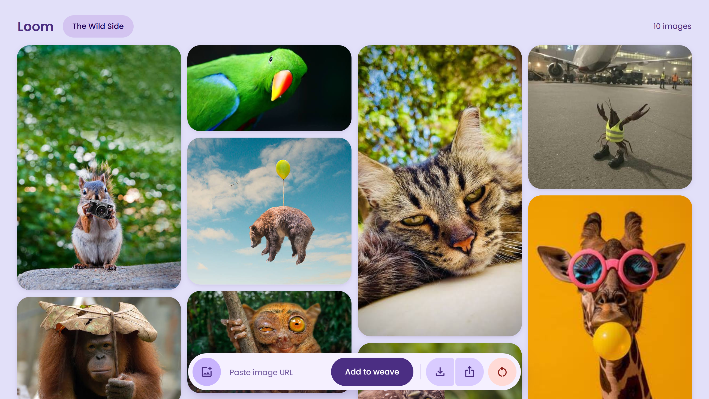

<h1 align="center">Loom</h1>

<p align="center">Weave your inspiration.</p>

<p align="center">
  <a href="https://nuvairea.github.io/loom/"><b>Live demo</b></a>
</p>

<p align="center">
  
</p>

## Table of Contents

- [How It Works](#how-it-works)
- [Tech Stack](#tech-stack)
- [Usage](#usage)
- [Project Structure](#project-structure)
- [Limitations](#limitations)

## How It Works

Loom turns your collected images into a single visual board. Add images by pasting a direct URL or uploading files from your device. URLs are checked before they enter the board, while uploaded images are downscaled to a maximum of 2400 pixels and re-encoded as WebP to keep storage small.

Arrange the board by dragging images into place. Loom maintains an animated masonry layout and provides confirmation before removing an individual image or clearing the entire board. Keep as many boards as you like and switch, rename, duplicate, or delete them from the title at the top, while the image count tracks the open board.

Your boards are saved locally in IndexedDB, with automatic migration from earlier versions. Export the finished board as a PNG, or use the Web Share API where it is supported. Loom adapts to light and dark system themes and uses a responsive floating control dock on different screen sizes.

## Tech Stack

- Plain HTML, CSS, and JavaScript (ES modules), no framework and no build step
- [Muuri](https://muuri.dev/) for the draggable masonry grid
- [html2canvas](https://html2canvas.hertzen.com/) for PNG export
- [idb](https://github.com/jakearchibald/idb) for IndexedDB access
- Poppins and Material Symbols from Google Fonts

All libraries load from a CDN, so an internet connection is required.

## Usage

1. Paste an image URL and press **Add to weave**, or use the upload button to pick files from your device.
2. Drag images to rearrange them.
3. Rename the board by clicking its title.
4. Use the export button to save the board as a PNG, or the share button to send it to another app.
5. Remove an image with its **x** button, or use the reset button to clear everything.

## Project Structure

```
loom/
├── index.html
├── css/               load order matters, see index.html
│   ├── tokens.css     colors, dark mode
│   ├── base.css       reset, body, pill buttons
│   ├── dock.css       bottom bar and tools
│   ├── topbar.css     wordmark, board chip, count
│   ├── boards.css     board switcher panel and menu
│   ├── meter.css      wavy storage meter
│   ├── tiles.css      masonry, items, empty state
│   ├── utilities.css  .hidden, reduced motion
│   └── overlays.css   modals, toast, broken image overlay
├── docs/              screenshots
└── js/
    ├── main.js        app wiring, grid setup, restore flow
    ├── moodboard.js   creates and removes board items
    ├── storage.js     IndexedDB persistence, boards, and migrations
    ├── optimize.js    image downscaling and WebP encoding
    ├── export.js      PNG export and sharing
    ├── validation.js  image URL validation
    ├── boards.js      board switcher, rename, duplicate, delete
    └── dom.js         shared DOM references
```

## Limitations

- Images added by URL must be publicly accessible, and the host must allow cross-origin requests
- Uploads are limited to 20MB each
- Boards live in your browser. Clearing site data erases them, and they do not sync across devices
